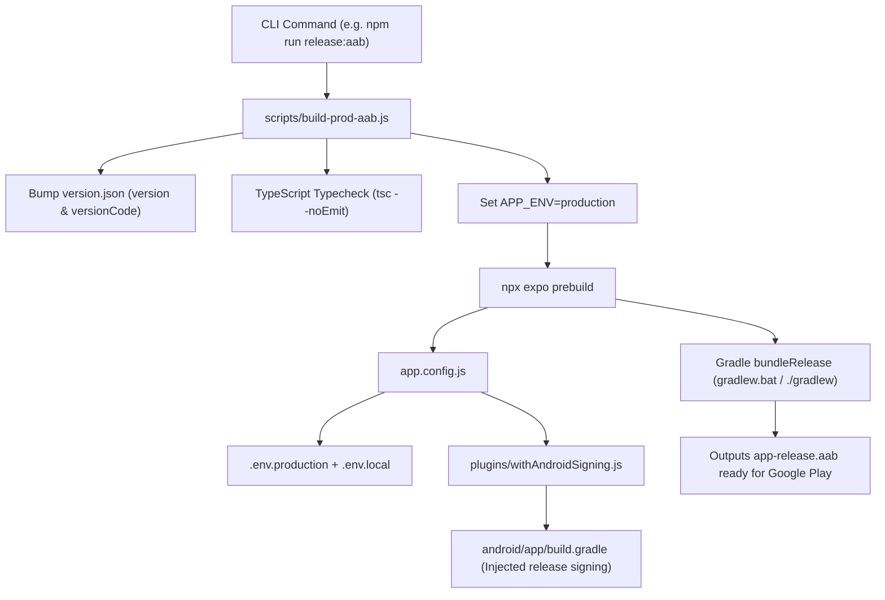

# Multi-Environment, Dynamic Multi-App Installation & Release Build System Guide

> **Purpose**: A plug-and-play architectural blueprint for Expo / React Native projects to support:
> 1. **Coexisting App Installs**: Installing Development (`.dev`) and Production (`prod`) builds side-by-side on the exact same mobile device without conflict.
> 2. **Environment Variable Splitting**: Dynamic loading of `.env.development`, `.env.production`, and gitignored `.env.local` for machine secrets.
> 3. **Automated Version Bumping**: Single-source `version.json` managing both SemVer strings and Android `versionCode`.
> 4. **Headless Android Signing**: Expo Config Plugin (`plugins/withAndroidSigning.js`) injecting release keystore credentials into `build.gradle` automatically during prebuild.
> 5. **One-Command Production AAB / Export Scripts**: Automated build pipeline for Google Play release AABs and JS bundle exports.

---

## Table of Contents
1. [Core Architectural Concept](#1-core-architectural-concept)
2. [Project File Structure Blueprint](#2-project-file-structure-blueprint)
3. [Step-by-Step Implementation Guide](#3-step-by-step-implementation-guide)
   - [Step 1: Environment Definition Files](#step-1-environment-definition-files)
   - [Step 2: Version Control Source of Truth](#step-2-version-control-source-of-truth)
   - [Step 3: Dynamic Expo Configuration (`app.config.js`)](#step-3-dynamic-expo-configuration-appconfigjs)
   - [Step 4: Android Release Signing Config Plugin](#step-4-android-release-signing-config-plugin)
   - [Step 5: Export & Generic Build Runner Script](#step-5-export--generic-build-runner-script)
   - [Step 6: One-Click Production AAB Release Builder](#step-6-one-click-production-aab-release-builder)
   - [Step 7: `package.json` Scripts Integration](#step-7-packagejson-scripts-integration)
4. [Generating a Production Keystore](#4-generating-a-production-keystore)
5. [Usage & CLI Command Reference](#5-usage--cli-command-reference)
6. [Troubleshooting & Pro-Tips](#6-troubleshooting--pro-tips)

---

## 1. Core Architectural Concept

### Why Multiple App Variants on One Device?
By default, mobile operating systems (Android & iOS) treat applications with the same package name / bundle identifier as identical. Installing a new build overwrites the existing one. 

By setting dynamic bundle identifiers:
- **Development**: `com.yourcompany.yourapp.dev` with display name **"YourApp (Dev)"**
- **Production**: `com.yourcompany.yourapp` with display name **"YourApp"**

You can have both versions running simultaneously on your testing phone or emulator, testing API parity and live releases without data loss.

### System Data Flow



---

## 2. Project File Structure Blueprint

When cloning this architecture to any upcoming project, set up the following files:

```
├── .env.development          <-- Public/dev variables (Dev package, Dev API, etc.)
├── .env.production           <-- Production variables (Prod package, Prod API, etc.)
├── .env.local                <-- [GITIGNORED] Machine secrets (Keystore password, keys)
├── version.json              <-- SemVer version + Android versionCode
├── app.config.js             <-- Dynamic Expo configuration loader
├── plugins/
│   └── withAndroidSigning.js <-- Injects keystore signing config into Android Gradle
├── scripts/
│   ├── export-build.js       <-- CLI runner: env setter, version bumper, expo export
│   └── build-prod-aab.js     <-- Automated end-to-end AAB release compiler
└── package.json              <-- Script aliases
```

---

## 3. Step-by-Step Implementation Guide

### Step 1: Environment Definition Files

#### `.env.development`
```ini
# Development configurations
APP_ENV=development
APP_NAME=YourApp (Dev)
APP_PACKAGE=com.yourcompany.yourapp.dev
EXPO_PUBLIC_API_URL=https://dev.api.yourcompany.com
```

#### `.env.production`
```ini
# Production configurations
APP_ENV=production
APP_NAME=YourApp
APP_PACKAGE=com.yourcompany.yourapp
EXPO_PUBLIC_API_URL=https://api.yourcompany.com
```

#### `.env.local` *(Add to `.gitignore`!)*
```ini
# Local machine secrets - NEVER COMMIT THIS FILE
RELEASE_KEYSTORE_PATH=../../my-release-key.keystore
RELEASE_KEYSTORE_PASSWORD=your_strong_keystore_password
RELEASE_KEY_ALIAS=your_key_alias
RELEASE_KEY_PASSWORD=your_strong_key_password
```

> [!IMPORTANT]
> The path in `RELEASE_KEYSTORE_PATH` is relative to the `android/app/` folder where Gradle executes (e.g. `../../my-release-key.keystore` resolves to project root).

---

### Step 2: Version Control Source of Truth

#### `version.json`
Place in the root of the project:
```json
{
  "version": "1.0.0",
  "versionCode": 1
}
```

---

### Step 3: Dynamic Expo Configuration (`app.config.js`)

Replace standard static `app.json` with dynamic `app.config.js`. This script parses `.env.{APP_ENV}` and `.env.local` without needing third-party libraries:

```javascript
const fs = require('fs');
const path = require('path');
const versionInfo = require('./version.json');

// Helper to load key-value pairs into process.env
function loadEnvFile(fileName) {
  const filePath = path.resolve(__dirname, fileName);
  if (!fs.existsSync(filePath)) return;

  const content = fs.readFileSync(filePath, 'utf-8');
  content.split(/\r?\n/).forEach((line) => {
    const trimmedLine = line.trim();
    if (!trimmedLine || trimmedLine.startsWith('#')) return;

    const match = trimmedLine.match(/^([\w.-]+)\s*=\s*(.*)?\s*$/);
    if (match) {
      const key = match[1];
      let value = match[2] || '';

      if (value.startsWith('"') && value.endsWith('"')) value = value.slice(1, -1);
      if (value.startsWith("'") && value.endsWith("'")) value = value.slice(1, -1);

      process.env[key] = value.trim();
    }
  });
}

// 1. Resolve environment target (defaults to development, detects EAS profile)
const easProfile = process.env.EAS_BUILD_PROFILE || 'development';
const appEnv = process.env.APP_ENV || (easProfile === 'production' ? 'production' : 'development');
console.log(`[app.config.js] Bootstrapping environment: "${appEnv}" (EAS Profile: "${easProfile}")`);

// 2. Load the targeted env file (.env.development or .env.production)
loadEnvFile(`.env.${appEnv}`);

// 3. Load machine-local secrets (.env.local) if present
loadEnvFile('.env.local');

module.exports = {
  expo: {
    name: process.env.APP_NAME || "YourApp",
    slug: "YourApp",
    version: versionInfo.version,
    orientation: "portrait",
    icon: "./assets/icon.png",
    userInterfaceStyle: "dark",
    scheme: "yourapp",
    ios: {
      supportsTablet: true,
      bundleIdentifier: process.env.APP_PACKAGE || "com.yourcompany.yourapp"
    },
    android: {
      adaptiveIcon: {
        foregroundImage: "./assets/adaptive-icon.png",
        backgroundColor: "#000000"
      },
      package: process.env.APP_PACKAGE || "com.yourcompany.yourapp",
      versionCode: versionInfo.versionCode,
      predictiveBackGestureEnabled: false
    },
    plugins: [
      "expo-router",
      "./plugins/withAndroidSigning" // Injects release signing
    ]
  }
};
```

---

### Step 4: Android Release Signing Config Plugin

#### `plugins/withAndroidSigning.js`
This Expo Config Plugin updates `android/app/build.gradle` automatically whenever `npx expo prebuild` runs:

```javascript
const path = require('path');
const { withAppBuildGradle } = require('@expo/config-plugins');

module.exports = function withAndroidSigning(config) {
  return withAppBuildGradle(config, (config) => {
    if (config.modResults.language === 'groovy') {
      config.modResults.contents = addSigningConfig(config.modResults.contents);
    }
    return config;
  });
};

function addSigningConfig(buildGradle) {
  const keystorePath = process.env.RELEASE_KEYSTORE_PATH;
  const keystorePassword = process.env.RELEASE_KEYSTORE_PASSWORD;
  const keyAlias = process.env.RELEASE_KEY_ALIAS;
  const keyPassword = process.env.RELEASE_KEY_PASSWORD;

  if (!keystorePath || !keystorePassword || !keyAlias || !keyPassword) {
    console.warn('[withAndroidSigning] Missing release signing env variables in .env.local. Skipping signing config.');
    return buildGradle;
  }

  // Resolve keystore path relative to android/app/
  let gradleKeystorePath = keystorePath;
  if (!path.isAbsolute(keystorePath) && !keystorePath.startsWith('..')) {
    gradleKeystorePath = `../../${keystorePath}`;
  }

  const releaseSigningBlock = `
        release {
            storeFile file("${gradleKeystorePath.replace(/\\/g, '/')}")
            storePassword "${keystorePassword}"
            keyAlias "${keyAlias}"
            keyPassword "${keyPassword}"
        }`;

  // 1. Inject release signing configuration inside signingConfigs
  if (buildGradle.includes('signingConfigs {') && !/signingConfigs\s*\{\s*release\s*\{/.test(buildGradle) && buildGradle.includes('debug {')) {
    buildGradle = buildGradle.replace(
      /signingConfigs\s*\{/,
      `signingConfigs {${releaseSigningBlock}`
    );
    console.log('[withAndroidSigning] Injected signingConfigs.release');
  }

  // 2. Point release build type to the release signingConfig
  const releaseBuildTypeRegex = /(buildTypes\s*\{[\s\S]*?release\s*\{[\s\S]*?signingConfig\s+signingConfigs\.)debug/;
  if (releaseBuildTypeRegex.test(buildGradle)) {
    buildGradle = buildGradle.replace(releaseBuildTypeRegex, '$1release');
    console.log('[withAndroidSigning] Updated buildTypes.release -> signingConfigs.release');
  } else if (buildGradle.includes('release {') && !buildGradle.includes('signingConfig signingConfigs.release')) {
    buildGradle = buildGradle.replace(
      /release\s*\{/,
      `release {\n            signingConfig signingConfigs.release`
    );
    console.log('[withAndroidSigning] Injected signingConfig into buildTypes.release');
  }

  return buildGradle;
}
```

---

### Step 5: Export & Generic Build Runner Script

#### `scripts/export-build.js`
A flexible wrapper script supporting SemVer bumps, TypeScript validation, cleaning old output, and executing any child build command with target environment variables:

```javascript
const fs = require('fs');
const path = require('path');
const { spawnSync } = require('child_process');

const colors = {
  reset: "\x1b[0m",
  green: "\x1b[32m",
  cyan: "\x1b[36m",
  yellow: "\x1b[33m",
  red: "\x1b[31m",
  bold: "\x1b[1m"
};

function log(msg, color = colors.reset) {
  console.log(`${color}${msg}${colors.reset}`);
}

// 1. Parse Arguments
const args = process.argv.slice(2);
let targetEnv = 'production';
let bumpType = 'patch';
let commandToRun = null;
let runTsc = true;
let bumpVersion = true;

for (let i = 0; i < args.length; i++) {
  if (args[i] === '--env' && args[i + 1]) {
    targetEnv = args[i + 1];
    i++;
  } else if (args[i] === '--bump' && args[i + 1]) {
    bumpType = args[i + 1];
    if (bumpType === 'none') bumpVersion = false;
    i++;
  } else if (args[i] === '--command' && args[i + 1]) {
    commandToRun = args[i + 1];
    i++;
  } else if (args[i] === '--no-tsc') {
    runTsc = false;
  }
}

log(`\n🚀 Starting build & export flow...`, colors.bold + colors.cyan);
log(`Environment:  ${targetEnv.toUpperCase()}`, colors.green);
log(`Bump Type:    ${bumpType}`, colors.green);

const versionPath = path.resolve(__dirname, '../version.json');
let versionInfo = { version: "1.0.0", versionCode: 1 };

if (fs.existsSync(versionPath)) {
  versionInfo = JSON.parse(fs.readFileSync(versionPath, 'utf8'));
}

const oldVersion = versionInfo.version;
const oldVersionCode = versionInfo.versionCode;

if (bumpVersion) {
  versionInfo.versionCode = (versionInfo.versionCode || 0) + 1;
  const parts = versionInfo.version.split('.').map(Number);
  if (parts.length === 3 && !parts.some(isNaN)) {
    if (bumpType === 'major') {
      parts[0] += 1; parts[1] = 0; parts[2] = 0;
    } else if (bumpType === 'minor') {
      parts[1] += 1; parts[2] = 0;
    } else {
      parts[2] += 1;
    }
    versionInfo.version = parts.join('.');
  }
  fs.writeFileSync(versionPath, JSON.stringify(versionInfo, null, 2), 'utf8');
  log(`✅ Version Bumped: ${oldVersion} (Code ${oldVersionCode}) ➡️  ${versionInfo.version} (Code ${versionInfo.versionCode})`, colors.bold + colors.green);
} else {
  log(`ℹ️  Skipping version bump (version: ${oldVersion}, versionCode: ${oldVersionCode})`, colors.yellow);
}

// 2. TypeScript Validation Check
if (runTsc) {
  log(`\n🔍 Checking TypeScript Types...`, colors.cyan);
  const tscResult = spawnSync('npx', ['tsc', '--noEmit'], { shell: true, stdio: 'inherit' });
  if (tscResult.status !== 0) {
    log(`❌ TypeScript validation failed. Fix compiling errors before build.`, colors.red);
    process.exit(1);
  }
  log(`✅ TypeScript compilation check passed!`, colors.green);
}

// 3. Clean dist directory if exporting
if (commandToRun && commandToRun.includes('expo export')) {
  log(`\n🧹 Cleaning previous dist folder...`, colors.cyan);
  const distPath = path.resolve(__dirname, '../dist');
  if (fs.existsSync(distPath)) {
    fs.rmSync(distPath, { recursive: true, force: true });
    log(`✅ Cleaned dist/ directory`, colors.green);
  }
}

// 4. Run Build Command
if (commandToRun && commandToRun !== 'none') {
  log(`\n🏃 Running: "${commandToRun}"`, colors.bold + colors.cyan);
  const buildEnv = {
    ...process.env,
    APP_ENV: targetEnv,
    EAS_BUILD_PROFILE: targetEnv === 'production' ? 'production' : 'development'
  };

  const runResult = spawnSync(commandToRun, {
    shell: true,
    stdio: 'inherit',
    env: buildEnv
  });

  if (runResult.status !== 0) {
    log(`❌ Command failed with code ${runResult.status}`, colors.red);
    process.exit(runResult.status || 1);
  }
  log(`🎉 Command completed successfully!`, colors.bold + colors.green);
}
```

---

### Step 6: One-Click Production AAB Release Builder

#### `scripts/build-prod-aab.js`
The end-to-end automated script specifically for Google Play `.aab` production releases:

```javascript
const fs = require('fs');
const path = require('path');
const { spawnSync } = require('child_process');

const colors = {
  reset: "\x1b[0m",
  green: "\x1b[32m",
  cyan: "\x1b[36m",
  yellow: "\x1b[33m",
  red: "\x1b[31m",
  bold: "\x1b[1m",
  magenta: "\x1b[35m"
};

function log(msg, color = colors.reset) {
  console.log(`${color}${msg}${colors.reset}`);
}

const args = process.argv.slice(2);
const shouldBump = !args.includes('--no-bump');
const bumpType = args.includes('--minor') ? 'minor' : (args.includes('--major') ? 'major' : 'patch');

log(`\n======================================================`, colors.bold + colors.cyan);
log(`🚀 Automated Production AAB Release Builder`, colors.bold + colors.magenta);
log(`======================================================\n`, colors.bold + colors.cyan);

// 1. Version Handling
const versionPath = path.resolve(__dirname, '../version.json');
let versionInfo = { version: "1.0.0", versionCode: 1 };
if (fs.existsSync(versionPath)) {
  try { versionInfo = JSON.parse(fs.readFileSync(versionPath, 'utf8')); } catch (e) {}
}

const oldVersion = versionInfo.version;
const oldCode = versionInfo.versionCode;

if (shouldBump) {
  versionInfo.versionCode = (versionInfo.versionCode || 0) + 1;
  const parts = versionInfo.version.split('.').map(Number);
  if (parts.length === 3 && !parts.some(isNaN)) {
    if (bumpType === 'major') { parts[0] += 1; parts[1] = 0; parts[2] = 0; }
    else if (bumpType === 'minor') { parts[1] += 1; parts[2] = 0; }
    else { parts[2] += 1; }
    versionInfo.version = parts.join('.');
  }
  fs.writeFileSync(versionPath, JSON.stringify(versionInfo, null, 2) + '\n', 'utf8');
  log(`📦 Version: ${oldVersion} (Code ${oldCode}) ➡️  ${versionInfo.version} (Code ${versionInfo.versionCode})`, colors.green);
} else {
  log(`📦 Version Kept: ${versionInfo.version} (Code ${versionInfo.versionCode})`, colors.yellow);
}

// 2. Production Environment
const prodEnv = {
  ...process.env,
  APP_ENV: 'production',
  EAS_BUILD_PROFILE: 'production',
  NODE_ENV: 'production',
  EXPO_IMAGE_UTILS_NO_SHARP: '1' // Avoid Sharp native build hangs on Windows
};

// 3. TypeScript Typecheck
if (!args.includes('--no-tsc')) {
  log(`\n🔍 Validating TypeScript Compilation...`, colors.bold + colors.cyan);
  const tscRes = spawnSync('npx', ['tsc', '--noEmit'], { shell: true, stdio: 'inherit', env: prodEnv });
  if (tscRes.status !== 0) {
    log(`\n❌ TypeScript compilation failed! Fix errors before release.`, colors.bold + colors.red);
    process.exit(1);
  }
  log(`✅ TypeScript compilation clean!`, colors.bold + colors.green);
}

// 4. Expo Prebuild with Production Variables
log(`\n⚙️  Running Expo Prebuild (Production Target)...`, colors.bold + colors.cyan);
const prebuildRes = spawnSync('npx', ['expo', 'prebuild', '--platform', 'android', '--no-install'], {
  shell: true,
  stdio: 'inherit',
  env: prodEnv
});

if (prebuildRes.status !== 0) {
  log(`\n❌ Expo prebuild failed with code ${prebuildRes.status}`, colors.bold + colors.red);
  process.exit(prebuildRes.status || 1);
}
log(`✅ Expo prebuild updated android/ native directory for production.`, colors.bold + colors.green);

// 5. Gradle bundleRelease
log(`\n🔨 Compiling Release Bundle via Gradle (bundleRelease)...`, colors.bold + colors.cyan);
const isWindows = process.platform === 'win32';
const gradlewCmd = isWindows ? 'gradlew.bat' : './gradlew';

const gradleRes = spawnSync(gradlewCmd, ['bundleRelease'], {
  cwd: path.resolve(__dirname, '../android'),
  shell: true,
  stdio: 'inherit',
  env: prodEnv
});

if (gradleRes.status !== 0) {
  log(`\n❌ Gradle bundleRelease failed with code ${gradleRes.status}`, colors.bold + colors.red);
  process.exit(gradleRes.status || 1);
}

// 6. Output Verification
const aabPath = path.resolve(__dirname, '../android/app/build/outputs/bundle/release/app-release.aab');

if (fs.existsSync(aabPath)) {
  const stats = fs.statSync(aabPath);
  const sizeMB = (stats.size / (1024 * 1024)).toFixed(2);
  
  log(`\n======================================================`, colors.bold + colors.green);
  log(`🎉 BUILD SUCCESSFUL! Production AAB Ready!`, colors.bold + colors.green);
  log(`======================================================`, colors.bold + colors.green);
  log(`📁 Artifact: ${aabPath}`, colors.cyan);
  log(`📊 Size:     ${sizeMB} MB`, colors.cyan);
  log(`🔖 Version:  ${versionInfo.version} (versionCode: ${versionInfo.versionCode})`, colors.cyan);
  log(`\n✨ Upload this .aab directly to Google Play Console!\n`, colors.bold + colors.green);
} else {
  log(`\n⚠️  Build completed but AAB was not found at ${aabPath}`, colors.yellow);
}
```

---

### Step 7: `package.json` Scripts Integration

Add these script shortcuts to your new project's `package.json`:

```json
{
  "scripts": {
    "start": "expo start",
    "android": "expo run:android",
    "ios": "expo run:ios",
    "bump-version": "node scripts/export-build.js --command none",
    "export:prod": "node scripts/export-build.js --env production --command \"npx expo export\"",
    "export:dev": "node scripts/export-build.js --env development --command \"npx expo export\"",
    "build:prod-local": "node scripts/export-build.js --env production --command \"npx expo prebuild --clean && cd android && gradlew assembleRelease\"",
    "build:prod-local-aab": "node scripts/export-build.js --env production --command \"npx expo prebuild --clean && cd android && gradlew bundleRelease\"",
    "release:aab": "node scripts/build-prod-aab.js"
  }
}
```

---

## 4. Generating a Production Keystore

To create a new release keystore for any upcoming project, run the standard JDK `keytool` command in your terminal:

```bash
keytool -genkeypair -v -storetype PKCS12 -keystore my-release-key.keystore -alias my-key-alias -keyalg RSA -keysize 2048 -validity 10000
```

1. Enter your secure password (twice).
2. Answer the organization questions (or press Enter to skip).
3. Confirm with `yes`.
4. Place `my-release-key.keystore` in the project root.
5. Add `*.keystore` and `.env.local` to `.gitignore`:
   ```gitignore
   # Private Keystores & Local Configs
   *.keystore
   .env.local
   ```
6. Update `.env.local` with the alias and passwords matching what you entered.

---

## 5. Usage & CLI Command Reference

### Daily Development
Runs with `APP_ENV=development` (`com.yourcompany.yourapp.dev`):
```bash
npm run android
```

### Pure Export (JavaScript Bundles)
```bash
# Production Export with automatic patch bump
npm run export:prod

# Development Export
npm run export:dev

# Export without bumping version
node scripts/export-build.js --env production --bump none --command "npx expo export"

# Export with minor bump (e.g. 1.0.13 -> 1.1.0)
node scripts/export-build.js --env production --bump minor --command "npx expo export"
```

### One-Click Production Google Play Bundle (.aab)
```bash
# Standard Production Build (patch bump + tsc + prebuild + bundleRelease)
npm run release:aab

# Build without bumping version
node scripts/build-prod-aab.js --no-bump

# Build with minor or major version bump
node scripts/build-prod-aab.js --minor
node scripts/build-prod-aab.js --major

# Skip TypeScript verification (useful for rapid debugging)
node scripts/build-prod-aab.js --no-tsc
```

---

## 6. Troubleshooting & Pro-Tips

### 1. Windows Gradle Path
In Windows PowerShell or CMD, Gradle wrapper is executed as `gradlew.bat`. The script automatically detects `process.platform === 'win32'` and switches between `gradlew.bat` and `./gradlew`.

### 2. Missing Sharp Native Module (`EXPO_IMAGE_UTILS_NO_SHARP=1`)
On Windows environments without C++ build tools, image optimization tools (`sharp`) can crash or hang during `expo prebuild`. The `build-prod-aab.js` script passes `EXPO_IMAGE_UTILS_NO_SHARP: '1'` in `env`, ensuring consistent builds across any developer workstation.

### 3. Keystore Path Resolution
Android's `gradlew` executes from the `android/app/` subdirectory. If your keystore is stored in the project root:
- From root: `./my-release-key.keystore`
- From `android/app/`: `../../my-release-key.keystore`
The `withAndroidSigning.js` plugin automatically normalizes relative paths starting without `..` by prepending `../../`.

### 4. Overwrite vs Side-by-Side Verification
To verify that both Dev and Production builds coexist on an Android device:
```bash
adb shell pm list packages | grep yourapp
# Output should show both:
# package:com.yourcompany.yourapp.dev
# package:com.yourcompany.yourapp
```
Both icons will appear independently on the phone's launcher screen.
